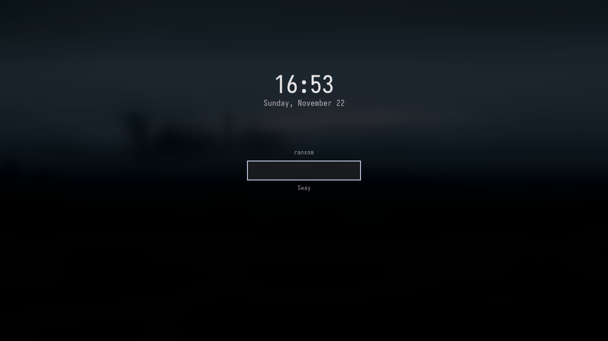
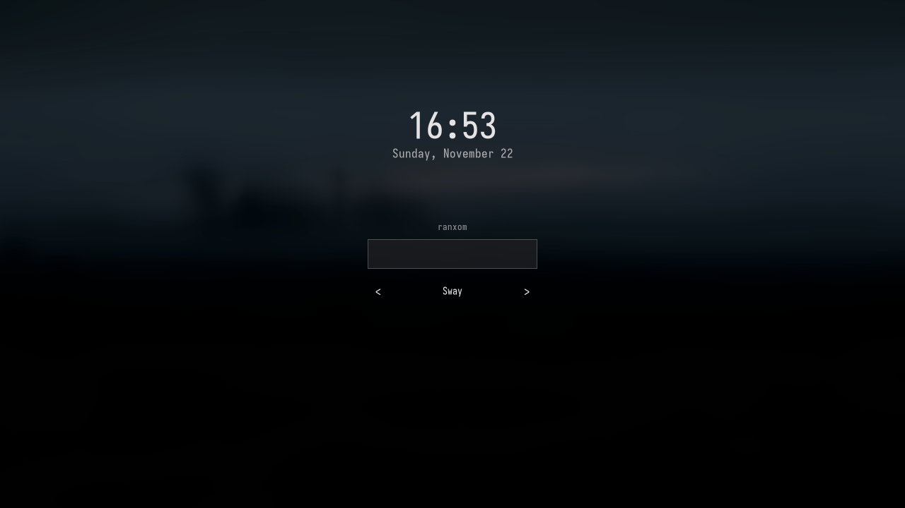
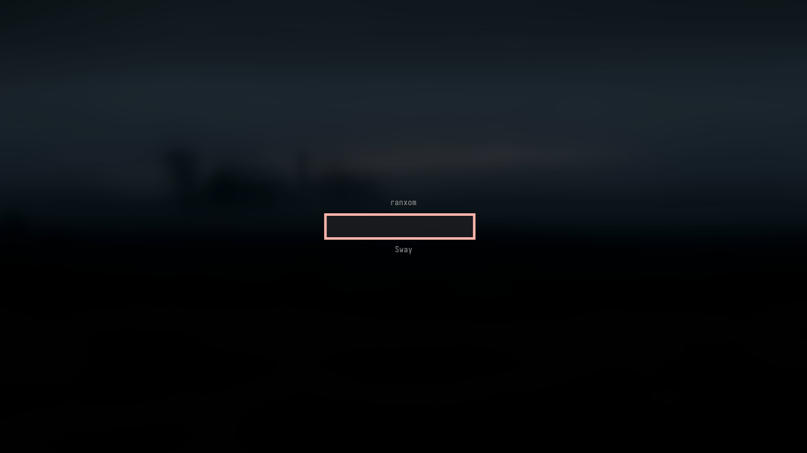
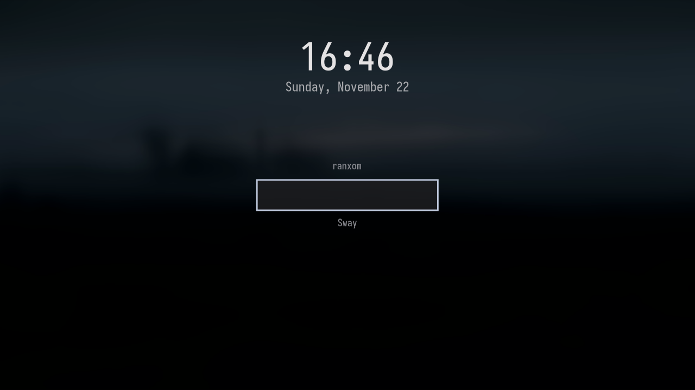

# rx-greeter

A small, fullscreen Wayland greeter for [greetd](https://git.sr.ht/~kennylevinsen/greetd)
that ports the look and interactions of
[VoidSDDM](https://github.com/talyamm/VoidSDDM) and adds:

- **Matugen colors**, generated with the same palette keys as the local
  `waylock` theme.
- **The current blurred Sway wallpaper**, read from
  `~/.cache/swaylock-bg.png` (the file `sway-wallpaper` already maintains).

It is written in C and uses Wayland, Cairo, xkbcommon, and json-c. There is no
Qt, GTK, Electron, or browser runtime. The greeter does not implement PAM;
greetd owns authentication.



| Session selector | Authentication error |
| --- | --- |
|  |  |

The same UI is rendered on every output. Fractional scaling is rendered at
native resolution through `wp_fractional_scale_v1` and `wp_viewporter`; the
primary output for keyboard focus is configurable.



These screenshots were captured with `grim` under headless Sway using the
Matugen theme and blurred wallpaper.

## Features

- Per-output `wlr-layer-shell` surfaces, so every monitor gets the greeter.
- Fractional-scale rendering with native-resolution buffers on 1.25/1.4/1.5
  scale outputs, plus integer-scale fallback.
- Cover-scaled, pre-blurred wallpaper and a configurable dark overlay.
- Centered password field with dots, waylock-compatible geometry, red error
  border and shake, and password clearing on failure.
- Optional clock and date (off by default for a minimal layout).
- User selector (`/etc/passwd`, uid >= 1000, valid shell).
- Session selector (`wayland-sessions` desktop files, local entries take
  precedence), including a configured session wrapper.
- Power selector plus F10 suspend, F11 poweroff, F12 reboot.
- Caps Lock indicator, fade-in, selector expand animations, help tips.
- Keyboard and mouse navigation.
- Split host configuration and Matugen-generated visual theme.
- Generic defaults: first human user, first available session, automatic
  background discovery, and sibling power-helper discovery.
- Matugen template, example theme, host config, and installer.
- Test-only virtual keyboard/pointer injector, mock greetd server, and a
  portable headless Sway integration test.

## Requirements

Build/runtime libraries (discovered with `pkg-config`):

- `wayland-client`, `wayland-protocols` (>= 1.32 for fractional scale),
  `wayland-scanner`
- `cairo`
- `xkbcommon`
- `json-c`
- `fontconfig`
- a readable font; the example uses **IosevkaTerm Nerd Font Mono** and falls
  back to `sans` if it is absent.

Compositor: Sway (a wlroots compositor with `wlr-layer-shell`,
`wp_fractional_scale_v1`, and `wp_viewporter`). Sway is used for the nested
greeter session. The host's Sway/SwayFX is not linked into the binary.

Test-only: `sway`, `grim`, Python 3. `make integration` needs wlroots virtual
keyboard and pointer protocol support.

## Build

```sh
devenv shell -- make
```

or, with the dependencies installed system-wide:

```sh
make
```

Outputs:

- `build/rx-greeter` — the greeter
- `build/rx-greeter-power` — fixed-action privileged helper
- `build/unit-tests` — unit tests
- `build/wl-input` — test-only input injector

The binary records ordinary shared-library sonames, not Nix store paths. After
a devenv build, `ldd build/rx-greeter` should resolve against the host
libraries.

## Complete setup from scratch

These steps take a machine from no rx-greeter install to a working greetd
greeter. Keep a spare TTY (Ctrl+Alt+F2) available before changing the live
greeter.

### 1. Install dependencies

Choose your distribution:

```sh
# Gentoo
sudo emerge --ask dev-build/make dev-util/pkgconf dev-libs/wayland \
  dev-libs/wayland-protocols x11-libs/cairo x11-libs/libxkbcommon \
  dev-libs/json-c media-libs/fontconfig gui-wm/sway sys-apps/dbus
# Optional test tools:
sudo emerge --ask media-gfx/grim dev-lang/python

# Arch
sudo pacman -S --needed base-devel pkgconf wayland wayland-protocols \
  cairo libxkbcommon json-c fontconfig sway grim dbus python

# Debian / Ubuntu
sudo apt install build-essential pkg-config libwayland-dev libwayland-bin \
  wayland-protocols libcairo2-dev libxkbcommon-dev libjson-c-dev \
  libfontconfig1-dev sway grim dbus python3

# Fedora
sudo dnf install gcc make pkgconf-pkg-config wayland-devel \
  wayland-protocols-devel cairo-devel libxkbcommon-devel json-c-devel \
  fontconfig-devel sway grim dbus-daemon python3
```

`wayland-protocols` must include `staging/fractional-scale` (1.32 or newer).
`sway` is required at runtime because it is the greeter compositor.

### 2. Build and test

```sh
git clone https://github.com/RanXom/rx-greeter.git
cd rx-greeter
devenv shell -- make
devenv shell -- make check
devenv shell -- make integration    # nested Sway + mock greetd + screenshots
```

If you do not use devenv, use `make`, `make check`, and `make integration`
directly.

### 3. Install

```sh
sudo make install
```

This installs the greeter, session wrapper, power helper, Matugen template,
example theme, example host config, and documentation under `/usr/local`.

Choose exactly one power policy:

```sh
# Setuid helper (mode 4750, group greetd)
sudo make install-power-setuid
```

or install normally and add a doas rule:

```
permit nopass greetd cmd /usr/local/libexec/rx-greeter-power
```

### 4. Create the theme and host config

If you already use Matugen and `sway-wallpaper`:

```sh
cd /path/to/rx-greeter
./scripts/install-user-theme.sh
./scripts/install-user-theme.sh --generate   # optional, regenerates theme
```

This creates:

- `~/.config/rx-greeter/theme.conf`
- `~/.config/rx-greeter/config.conf`
- `~/.config/matugen/templates/rx-greeter.conf`
- a `[templates.rx-greeter]` block in `~/.config/matugen/config.toml`

Then make the host config readable by greetd. If `/home` is traversable by
greetd (the common 755/644 setup), copy it:

```sh
sudo install -d /etc/rx-greeter
sudo install -m644 ~/.config/rx-greeter/config.conf /etc/rx-greeter/config.conf
```

If the user's home is private, stage copies instead:

```sh
sudo /usr/local/libexec/rx-greeter-sync-assets --user "$USER"
```

The second form writes `/var/lib/rx-greeter/{theme.conf,config.conf,background.png}`,
which the greeter reads when the user config is inaccessible. Re-run it after
wallpaper or Matugen changes.

Without Matugen, use the installed examples:

```sh
sudo install -d /etc/rx-greeter
sudo install -m644 /usr/local/share/rx-greeter/theme.conf /etc/rx-greeter/theme.conf
sudo install -m644 /usr/local/share/rx-greeter/config.conf /etc/rx-greeter/config.conf
sudoedit /etc/rx-greeter/theme.conf /etc/rx-greeter/config.conf
```

Set `background_image` in `/etc/rx-greeter/config.conf` to the pre-blurred
wallpaper, or leave it empty to search `$HOME/.cache`, `/var/lib`, and `/etc`.

### 5. Verify permissions and configuration

```sh
# Verify as the greetd user, not just as yourself.
sudo -u greetd /usr/local/bin/rx-greeter \
  --config /etc/rx-greeter/config.conf --check-config

# Check theme/wallpaper search and effective settings.
rx-greeter --check-config
rx-greeter --print-config
```

For a per-user Matugen theme, `theme_path` must be readable by greetd. If it is
not, use the sync script above.

### 6. Choose the display and scale

Multi-output is automatic: every output gets the full greeter UI. Keyboard
focus goes to:

1. `RX_GREETER_OUTPUT` environment variable, if set
2. `output` in the host config, if set
3. the first output

Example:

```ini
# /etc/rx-greeter/config.conf
output = eDP-1
```

For a HiDPI output, tell the greeter's Sway session the scale. Put it in the
greetd command or the environment used to start the session:

```toml
command = "/usr/bin/env RX_GREETER_OUTPUT_SCALE=1.4 /usr/local/bin/rx-greeter-session"
```

The greeter receives fractional scale from Sway and renders at native
resolution. Non-primary outputs use on-demand keyboard focus; clicking them
moves focus.

### 7. Test the real session wrapper before switching greetd

The nested integration tests are the primary safety net. You can also launch
the installed session script manually on a spare VT with a test config:

```sh
sudo -u greetd env \
  RX_GREETER_CONFIG=/etc/rx-greeter/config.conf \
  RX_GREETER_LOG=/tmp/rx-greeter-test.log \
  WLR_BACKENDS=headless WLR_RENDERER=pixman WLR_LIBINPUT_NO_DEVICES=1 \
  /usr/local/bin/rx-greeter-session
```

The headless backend verifies the wrapper and compositor startup without
touching a real VT. Use the integration test for input/auth behavior.

### 8. Back up and switch greetd

```sh
sudo cp -a /etc/greetd/config.toml /etc/greetd/config.toml.bak
sudoedit /etc/greetd/config.toml
```

Use the stanza from `configs/greetd-config.toml`:

```toml
[terminal]
vt = 7

[default_session]
command = "/usr/local/bin/rx-greeter-session"
user = "greetd"
```

Restart greetd using your init system:

```sh
sudo systemctl restart greetd              # systemd
sudo rc-service greetd restart             # OpenRC, service named greetd
sudo rc-service display-manager restart    # OpenRC Gentoo greetd service
```

On the machine this project was developed on, the OpenRC service is
`display-manager`, not `greetd`.

If the greeter does not appear, switch to a spare TTY, log in, restore the
backup, and restart greetd:

```sh
sudo cp -a /etc/greetd/config.toml.bak /etc/greetd/config.toml
sudo systemctl restart greetd
# or: sudo rc-service greetd restart
# or: sudo rc-service display-manager restart
```

### 9. Troubleshooting

- `no theme file found` → set `theme_path` in the host config or install
  `/etc/rx-greeter/theme.conf`.
- `no executable power helper found` → install the setuid helper or add the
  doas rule.
- `compositor does not advertise wlr-layer-shell` → the session is not using
  Sway/the provided wrapper.
- Wallpaper is solid black → `background_image` is unreadable by greetd; use
  the sync script.
- Text is soft at a fractional scale → set `RX_GREETER_OUTPUT_SCALE` to the
  same scale as the user's Sway session; the greeter will use fractional
  buffers.
- Keyboard focus is on the wrong monitor → set `output` or
  `RX_GREETER_OUTPUT`.
- Inspect the session log with `RX_GREETER_LOG=/path` in the greetd command,
  or use `journalctl -u greetd` / `rc-service display-manager status` for the
  syslog start line.

## Test

```sh
devenv shell -- make check        # parser/password/session/greetd unit tests
devenv shell -- make integration  # nested headless Sway + mock greetd
devenv shell -- make multioutput  # two headless outputs at fractional scale
```

`make integration` is portable: it creates its own temporary Wayland session
entry, wallpaper, visual theme, and host config. It does not depend on the
host user's `wayland-sessions`, home directory, or theme. It verifies:

- split config/theme loading and the configured session argv
- typing, Backspace, Escape, Tab and Shift+Tab
- password dots, Caps Lock on/off
- user, session, and power selectors; mouse clicks on arrows and outside
- two outputs at scale 1.4, the selected primary output, keyboard input on it,
  and a mouse click on the non-primary output
- F10/F11/F12 power dry-runs
- authentication error feedback and password clearing
- the visible auth-message path
- `create_session` → secret response → `success` → `start_session`

Screenshots are written under `build/test-artifacts/<timestamp>/` with `grim`.

The test binary and mock are not part of the installed greeter. The
multi-output test confirms that buffers are created at physical resolution
while UI geometry remains logical, and that keyboard focus follows the
configured primary output.

## Install

```sh
sudo make install
```

By default this installs:

| Path | Purpose |
| --- | --- |
| `/usr/local/bin/rx-greeter` | greeter |
| `/usr/local/bin/rx-greeter-session` | greetd session wrapper |
| `/usr/local/libexec/rx-greeter-power` | fixed-action power helper |
| `/usr/local/libexec/rx-greeter-sync-assets` | optional greetd-readable asset sync |
| `/usr/local/share/rx-greeter/theme.conf` | visual theme example |
| `/usr/local/share/rx-greeter/config.conf` | host config example |
| `/usr/local/share/rx-greeter/greetd-config.toml` | example greetd stanza |
| `/usr/local/share/rx-greeter/matugen/rx-greeter.conf` | Matugen template |
| `/usr/local/share/rx-greeter/install-user-theme.sh` | user Matugen installer |

`make install-system-config` installs the example theme and host config to
`/etc/rx-greeter/` only when those files do not already exist. If you use a
per-user Matugen theme, either edit `/etc/rx-greeter/config.conf` to point at
that theme or skip `install-system-config` and use the user config/command-line
environment override.

### Power helper policy

The greeter runs as the `greetd` user and cannot power off/reboot/suspend
directly. The helper accepts exactly `suspend`, `poweroff`, or `reboot`; no UI
string is ever passed to a shell.

Option A — setuid root, executable only by root/greetd:

```sh
sudo make install-power-setuid
```

This installs mode `4750`, owner `root:greetd`.

Option B — doas. Install normally, then add a doas rule for the greetd user:

```
permit nopass greetd cmd /usr/local/libexec/rx-greeter-power
```

When the helper is not root it re-executes itself through
`/usr/bin/doas -n -u root`. Set `RX_GREETER_POWER_NO_DOAS=1` to disable that
behavior.

Both the selector and F10/F11/F12 call the same helper. `--power-dry-run` (or
`RX_GREETER_POWER_DRY_RUN=1`) only prints the action and is what the integration
test uses.

## Configuration

Configuration is split deliberately:

- **`theme.conf`** is generated by Matugen and owns appearance only: colors,
  geometry, dots, fonts, fade/animation, clock/date, selector styling, and
  error styling.
- **`config.conf`** is machine/user policy: theme path, wallpaper, default
  user/session, session directories, power helper, and dry-run policy.
- Built-in defaults are generic.

Search order for the host config:

1. `--config PATH`
2. `$RX_GREETER_CONFIG`
3. `/etc/rx-greeter/config.conf`
4. `/var/lib/rx-greeter/config.conf`
5. `/usr/local/etc/rx-greeter/config.conf`
6. `$XDG_CONFIG_HOME/rx-greeter/config.conf`
7. `$HOME/.config/rx-greeter/config.conf`

Search order for the visual theme:

1. `--theme PATH`
2. `$RX_GREETER_THEME`
3. `theme_path` from the host config
4. `/etc/rx-greeter/theme.conf`
5. `/var/lib/rx-greeter/theme.conf`
6. `/usr/local/etc/rx-greeter/theme.conf`
7. `$XDG_CONFIG_HOME/rx-greeter/theme.conf`
8. `$HOME/.config/rx-greeter/theme.conf`
9. `/usr/local/share/rx-greeter/theme.conf`
10. `/usr/share/rx-greeter/theme.conf`

Precedence for any key is:

```
CLI > environment > host config > theme > built-in defaults
```

An explicitly configured but unreadable config, theme, or background is
reported rather than silently ignored. `~` and `$HOME` are expanded in path
values.

Example host config (this is the per-user Matugen setup; a generic system
config can leave defaults empty):

```ini
# /etc/rx-greeter/config.conf
theme_path = /home/ranxom/.config/rx-greeter/theme.conf
background_image = /home/ranxom/.cache/swaylock-bg.png
default_user = ranxom
default_session = sway
# output = eDP-1
# session_dirs = /usr/local/share/wayland-sessions:/usr/share/wayland-sessions
# power_helper = /usr/local/libexec/rx-greeter-power
```

Empty values mean:

- `default_user` → first selectable human user
- `default_session` → first available Wayland session
- `background_image` → search `$HOME/.cache`, `/var/lib`, `/etc`, `/usr/share`
- `power_helper` → sibling `rx-greeter-power`, then standard libexec paths
- `output` → first output; set it to a `wl_output` name (e.g. `eDP-1`) to keep
  keyboard focus on a specific display

Validate the effective configuration without starting a compositor:

```sh
rx-greeter --check-config
rx-greeter --print-config
```

`--check-config` exits nonzero for unreadable explicit paths, a missing
power helper, no selectable users, no Wayland sessions, or a nonexistent
configured default user.

### Theme key reference

Colors and field geometry intentionally use the same names as waylock:

```ini
background_image
background_color
background_overlay
surface_color
surface_opacity
text_color
primary_color
error_color
outline_color

box_width
box_height
border_radius
box_x
box_y
dot_spacing
dot_radius

font_family
fallback_font_family
font_size
fade_ms
animation_ms
element_opacity
element_spacing
show_cursor
```

Greeter-specific keys:

```ini
show_clock
show_date
clock_format
date_format
clock_font_family
clock_font_size
date_font_size
clock_color
clock_x
clock_y

show_help_tips
help_tips_font_size
help_tips_color
show_caps_lock_indicator
caps_lock_font_size
caps_lock_color

show_user_selector
show_session_selector
show_power_buttons
show_selector_preview
selector_preview_font_size
selector_preview_color
selector_preview_margin
selector_height
selector_spacing
selector_font_size
selector_arrow_font_size
selector_arrow_width
selector_radius

default_user
default_session
output
session_dirs
allow_empty_password
clear_password_on_error
login_error_shake
login_error_border_width
error_hold_ms
auth_timeout_ms
power_helper
power_dry_run
```

See [`configs/theme.conf`](configs/theme.conf) and
[`configs/config.conf`](configs/config.conf).

Clock/date formats are `strftime(3)` formats (`%H:%M`, `%A, %B %d`), not the
VoidSDDM JavaScript placeholders. Dead keys work through xkbcommon compose.

## Matugen

The user setup script installs the template and initial theme:

```sh
./scripts/install-user-theme.sh
# or, to immediately regenerate the theme (and all other Matugen outputs):
./scripts/install-user-theme.sh --generate
```

It backs up `~/.config/matugen/config.toml`, installs
`~/.config/matugen/templates/rx-greeter.conf`, adds:

```toml
[templates.rx-greeter]
input_path = "/home/ranxom/.config/matugen/templates/rx-greeter.conf"
output_path = "/home/ranxom/.config/rx-greeter/theme.conf"
```

and creates a user host config at `~/.config/rx-greeter/config.conf`.

`sway-wallpaper` already calls Matugen, so future wallpaper changes regenerate
`~/.config/rx-greeter/theme.conf` automatically. The template uses the same
color keys as waylock:

```ini
background_color = {{ colors.surface.default.hex }}
surface_color = {{ colors.surface_container.default.hex }}
text_color = {{ colors.on_surface.default.hex }}
primary_color = {{ colors.primary.default.hex }}
error_color = {{ colors.error.default.hex }}
outline_color = {{ colors.outline.default.hex }}
```

## Wallpaper synchronization

The default background is the same pre-blurred file used by waylock:

```
~/.cache/swaylock-bg.png
```

`~/.local/bin/sway-wallpaper` generates it with ffmpeg and regenerates Matugen
outputs. rx-greeter never takes a screenshot and never re-blurs at login. Only
PNG is supported by Cairo's image loader.

The user's home and cache directories are usually traversable/readable by
greetd (`namei -l` shows 755/644), so the greeter can read the live Matugen
theme and wallpaper directly through `config.conf`. If a future setup makes the
home private, stage readable copies:

```sh
sudo /usr/local/libexec/rx-greeter-sync-assets --user ranxom
```

That writes `/var/lib/rx-greeter/theme.conf`, `background.png`, and a fallback
`config.conf`, and is automatically found by the greeter. Re-run it after
wallpaper/Matugen changes. The script accepts `--theme`, `--user`, and
`--default-session`; it uses `SUDO_USER` when no user is specified.

## Session and compositor

`rx-greeter-session` is modeled on `noctalia-greeter-session`:

- creates a private `XDG_RUNTIME_DIR`
- unsets stale `WAYLAND_DISPLAY`, `SWAYSOCK`, and `I3SOCK`
- runs under `dbus-run-session`
- selects the first non-NVIDIA DRM device with a connected output, or honors
  `RX_GREETER_DRM_CARD` / `RX_GREETER_DRM_RENDER`
- starts a minimal Sway with no user config, bars, idle daemons, or wallpaper
- launches rx-greeter as the only fullscreen window
- exits Sway when the greeter exits, so greetd can start the chosen session
- parks stdout/stderr off the VT by default

Useful environment variables:

| Variable | Meaning |
| --- | --- |
| `RX_GREETER_BIN` | greeter binary |
| `RX_GREETER_CONFIG` | host config path |
| `RX_GREETER_THEME` | visual theme path |
| `RX_GREETER_LOG` | `stderr`, `none`, or a writable file path |
| `RX_GREETER_DRM_CARD` / `RX_GREETER_DRM_RENDER` | override DRM device paths |
| `RX_GREETER_DGPU_OFF` | optional executable to power off the dGPU |
| `RX_GREETER_OUTPUT` | primary output name for keyboard focus |
| `RX_GREETER_XKB_LAYOUT` / `_VARIANT` / `_OPTIONS` | keyboard layout/options |
| `RX_GREETER_OUTPUT_SCALE` | Sway output scale, e.g. `1.4` |
| `RX_GREETER_COMPOSITOR` | compositor binary (default `sway`) |
| `WLR_LOG` | wlroots log level |

The minimal Sway config does not set an output scale. On a HiDPI display,
export `RX_GREETER_OUTPUT_SCALE` (the user's Sway config here uses `1.4`). The
greeter receives the fractional scale from the compositor and creates physical
buffers at that resolution, so text and borders stay crisp. Set
`RX_GREETER_OUTPUT` or the host config `output` key to choose the display that
holds exclusive keyboard focus; every other output still gets the full UI with
on-demand keyboard focus.

The NVIDIA dGPU is kept out of wlroots by the DRM selection. To actively power
it off, add a fixed hook at `<prefix>/libexec/rx-greeter-dgpu-off` or set
`RX_GREETER_DGPU_OFF`; the script runs it best-effort. Do not point it at a
script that prompts or blocks for a long time.

## greetd configuration

Do not edit the live file until the greeter has passed testing. Back it up
first:

```sh
sudo cp -a /etc/greetd/config.toml /etc/greetd/config.toml.bak
```

Example stanza (also at
[`configs/greetd-config.toml`](configs/greetd-config.toml)):

```toml
[terminal]
vt = 7

[default_session]
command = "/usr/local/bin/rx-greeter-session"
user = "greetd"
```

If you use a per-user theme and do not install a system config, pass the paths
explicitly:

```toml
command = "/usr/bin/env RX_GREETER_CONFIG=/home/ranxom/.config/rx-greeter/config.conf /usr/local/bin/rx-greeter-session"
```

The greeter connects to `$GREETD_SOCK`, sends `create_session`, answers
`auth_message` prompts, sends `start_session`, and exits so greetd can launch
the session. `auth_error` keeps the greeter running with the password cleared.
Escape during authentication sends `cancel_session`.

## Keys

| Key | Action |
| --- | --- |
| Up / Down | move between password, user, session, power |
| Tab / Shift+Tab | cycle focus, skipping hidden selectors |
| Left / Right | change the active selector |
| Enter | submit password, confirm power item, or return from user/session selector |
| Escape | clear password, leave a selector, or cancel authentication |
| Ctrl+U | clear password |
| F10 | suspend |
| F11 | poweroff |
| F12 | reboot |

Mouse clicks work on the field, selector arrows/labels, previews, and power
labels. Clicking outside an open selector returns focus to the password field.
Set `show_cursor = false` to hide the compositor cursor.

## Security notes

- Authentication is entirely greetd/PAM. rx-greeter never reads `/etc/shadow`.
- Passwords are not logged. The test debug status file contains only
  `password_len`, never password text.
- The password buffer and serialized greetd request buffer are zeroed after
  use; the mock test logs only response lengths.
- The power helper accepts a fixed action enum and never invokes a shell.
- Debug status files are mode `0600` and are opt-in (`--debug-status PATH`).
- Syslog diagnostics include errors and auth failures, never password data.

## Known limitations

- Multi-output is implemented as one layer surface per output. All outputs
  show the same UI state; there is no separate per-output layout.
- Fractional scaling requires a compositor that advertises both
  `wp_fractional_scale_v1` and `wp_viewporter`. Without them the greeter falls
  back to the compositor's integer output scale.
- The optional VoidSDDM show-password eye button is not ported.
- No avatar/image selector previews; user and session previews are text.
- No remembered last user/session.
- The session list reads `/usr/local/share/wayland-sessions` and
  `/usr/share/wayland-sessions` by default; it deliberately does not use
  `~/.local/share/wayland-sessions` because the greeter runs as greetd.
  `session_dirs` can override the list.
- Real greetd on a VT, suspend, reboot, and poweroff have not been exercised
  in this repository; use the nested/mock tests and the helper's dry-run mode,
  then test in a VM or spare TTY before switching the live config.
- Multi-output and fractional scaling are exercised with two headless Sway
  outputs at scale 1.4, not on physical mixed-DPI hardware.
- The included Matugen and host-config examples use `ranxom`; edit them for
  another user or use the installer/sync scripts.

## License

MIT. See [LICENSE](LICENSE).
